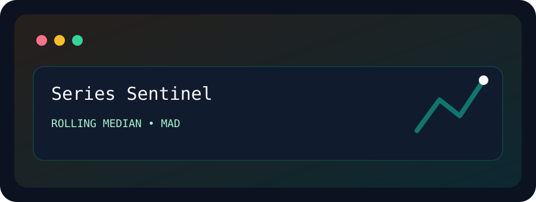

<div align="center">


[](LICENSE)
[](https://www.python.org/)
[](https://github.com/CyberLoop-dev/series-sentinel/stargazers)
[](https://github.com/CyberLoop-dev/series-sentinel/commits/main)

**A small, explainable anomaly detector for CSV time series.**



</div>

## 🧭 Overview

Series Sentinel scans a numeric CSV column in row order and compares each value with a rolling window of previous observations. It uses the median and median absolute deviation (MAD), making the baseline less sensitive to earlier outliers.

## ✨ Features

- 📈 Reads timestamped or plain numeric CSV series.
- 🧮 Uses rolling median and median absolute deviation.
- 🚩 Reports anomaly rows with baseline and score details.
- 📄 Exports JSON or CSV reports.
- 🐍 Uses only the Python standard library.

## 🖥️ Demo

```bash
python main.py examples/series.csv --value-column value --time-column timestamp --window 5
```
The included sample has one intentionally unusual final observation.

## 🚀 Quick Start

```bash
git clone https://github.com/CyberLoop-dev/series-sentinel.git
cd series-sentinel
python main.py examples/series.csv --value-column value --window 5
```

## 🧱 Tech Stack

- 🐍 Python 3.10+
- 📦 Standard library: argparse, csv, json, statistics

## 🗂️ Folder Structure

```text
series-sentinel/
├── main.py
├── examples/series.csv
├── tests/test_main.py
├── pyproject.toml
├── assets/illustration.svg
├── .gitignore
└── README.md
```

## 🛣️ Roadmap

- [x] Rolling median/MAD detection
- [x] JSON and CSV reports
- [ ] Optional rolling IQR detector

## 🤝 Contributing

Issues and pull requests are welcome. Please include a clear reproduction or sample input and keep changes focused.

## 📄 License

Released under the [MIT License](LICENSE).

<div align="center">


</div>
